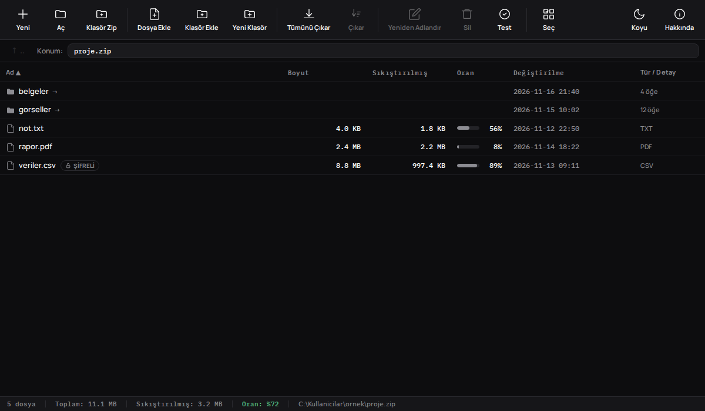
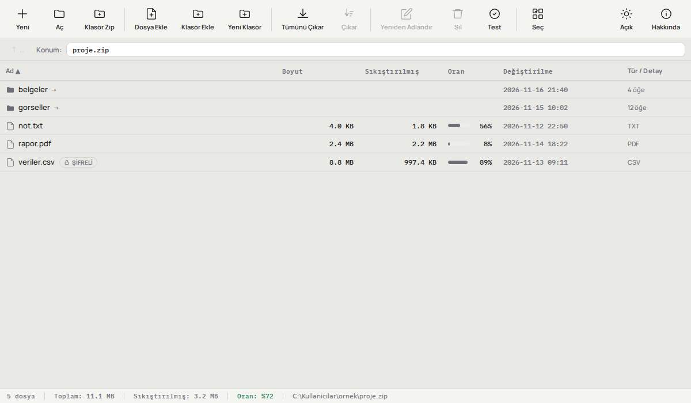

<div align="center">
  

  # Ziptul

  **Türkiye’de geliştirilen, açık kaynaklı ve Türkçe ZIP arşiv programı.**
  Bir [Tulvez açık kaynak](https://opensource.tulvez.com/) projesi.

  [](LICENSE)
  [](https://tauri.app)
  [](https://www.rust-lang.org)
</div>

---

## İndir

Kurulum dosyaları her sürümde [Releases](https://github.com/tulvez/ziptul/releases) sayfasında yayımlanır.

| Sistem | Dosya |
|---|---|
| Windows | `Ziptul_<sürüm>_x64-setup.exe` — Tulvez Noir kurulum sihirbazı; yönetici izni istemez, `.zip` dosyalarını Ziptul ile ilişkilendirir |
| Linux | `.AppImage` (bütün dağıtımlar) ya da `.deb` (Ubuntu, Debian, Mint, Pop!_OS) |
| macOS | `.dmg` (Apple Silicon) |

> **Windows uyarısı:** Kurulum dosyası henüz kod imzası taşımadığı için Windows “Windows bilgisayarınızı korudu” uyarısı gösterebilir. Dosyayı yalnız bu depodaki Releases sayfasından indirin.

## Ekran görüntüleri

| Koyu tema | Açık tema |
|---|---|
|  |  |

## Özellikler

- ZIP oluşturma, açma, çıkarma; klasörü tek adımda arşivleme
- Arşiv içinde taşıma, kopyalama, yeniden adlandırma, silme ve klasör oluşturma
- Sürükle-bırak, kes / kopyala / yapıştır, çoklu seçim
- Gezgin sağ tık menüsü: **Ziptul ile zip'le**, **Ziptul ile çıkar** (arşiv adıyla bir klasöre), **Ziptul ile aç** — hiçbir dosyanın üstüne yazılmaz (Windows 11'de “Daha fazla seçenek göster” altında)
- AES-256 ile parolalı arşiv; arşiv bütünlük testi
- İşlem ilerlemesi ve iptal
- Koyu, açık ve sistem teması (Tulvez Noir)

## Gizlilik

Ziptul **hiçbir kişisel veri, kullanım ölçümü ya da dosya bilgisi toplamaz ve göndermez**. Arşivler yalnız bilgisayarınızda işlenir; yazı tipleri dahil her şey uygulamanın içindedir.

Tek ağ isteği **güncelleme denetimidir**: GitHub’dan son sürüm numarası okunur (bu sırada bilgisayarınızın IP adresini GitHub görür). Açılıştaki otomatik denetim en çok günde bir yapılır ve **Hakkında → Uygulama** bölümünden kapatılabilir.

## Güvenlik

- Pencerede sıkı içerik güvenlik politikası (CSP) vardır; uygulama yalnız kendi dosyalarını ve GitHub sürüm API’sini kullanır.
- Arşiv çıkarılırken dosya adları temizlenir; `../` ile hedef klasörün dışına yazılamaz.
- Arşivdeki bir program ya da betik (`.exe`, `.bat`, `.ps1` …) çift tıklandığında önce uyarı gösterilir.
- Uygulama yalnız kendi geçici klasöründeki dosyaları açar ve yalnız güvenilen adresleri (`github.com/tulvez`, `*.tulvez.com`) tarayıcıda açar.
- Sürüm notları HTML olarak değil düz metin olarak gösterilir.

Bir güvenlik açığı bulduysanız herkese açık bir konu açmak yerine [security.tulvez.com](https://security.tulvez.com/) adresindeki yolu izleyin.

## Kaynaktan derleme

Gerekenler: [Rust](https://www.rust-lang.org/tools/install) (stable), Node.js 22+, [Tauri v2 ön koşulları](https://tauri.app/start/prerequisites/).

```bash
npm install
npm run tauri dev     # geliştirme
npm run tauri build   # kurulum dosyaları: src-tauri/target/release/bundle/
```

Windows kurulum sihirbazı (NSIS, Tulvez Noir koyu): `npm run tauri build -- --bundles nsis` → `src-tauri/target/release/bundle/nsis/`

## Proje yapısı

```
src/                      React + TypeScript arayüz
  App.tsx                 ana durum ve işlemler
  tema.ts                 koyu / açık / sistem teması
  guncelleme.ts           güncelleme denetimi (kapatılabilir)
  components/             araç çubuğu, dosya listesi, pencereler
  styles/global.css       Tulvez Noir teması
src-tauri/                Rust (Tauri v2)
  src/commands/           arşiv okuma, yazma, düzenleme komutları
  capabilities/           pencere izinleri (en az yetki)
  windows/                NSIS kurulum sihirbazı: şablon, Türkçe metinler, Noir görseller
```

## Katkı

Hata bildirimleri ve öneriler için [bir konu açın](https://github.com/tulvez/ziptul/issues). Değişiklik önerileri (pull request) memnuniyetle karşılanır; lütfen değişikliğin neyi neden yaptığını kısaca açıklayın.

## Lisans

[MIT](LICENSE) — © 2026 Tulvez ve Ziptul katkıda bulunanlar.
